# ghost-hunter

**Find code injected into running Windows processes.** ghost-hunter looks for reflectively loaded DLLs, shellcode threads, hollowed processes, inline and import-table hooks, stomped modules, and implants sleeping with their code encrypted (sleep masking). It reads each process from the outside and never writes to one. It needs nothing but Python's standard library.

[](https://github.com/njuj/ghost-hunter/actions/workflows/ci.yml)


<p align="center"></p>

<p align="center"></p>

Malware likes to live inside someone else's process. Once it is there it has no file of its own, and its code runs under the name of `explorer.exe` or `svchost.exe`. EDR products look for that. ghost-hunter does the same in about 1,300 readable lines, and it explains every finding in plain words.

```text
$ ghost-hunter --pid 14120 --pid 11968 --pid 12768 --pid 20704

 ghost-hunter v0.2.0  ·  4 processes  ·  0.4s

 python.exe  pid 14120
   ✖ CRITICAL 1 thread started in memory no file stands behind  0x21052f30000  T1055
              └ thread 8224 began in private RX memory at 0x21052f30000 (4,096 bytes): code injected and
                started with CreateRemoteThread or a similar call
                c3 c3 c3 c3 c3 c3 c3 c3 c3 c3 c3 c3 c3 c3 c3 c3

 python.exe  pid 11968
   ✖ CRITICAL 1 function hooked into memory no file stands behind  0x7ffb4010f980  T1055
              └ kernel32.dll!Beep now jump to private memory at 0x21dd7880000: injected code runs before
                the real function
                ff 25 00 00 00 00 00 00 88 d7 1d 02 00 00 e8 21

 python.exe  pid 12768
   ✖ CRITICAL 1 thread running code no file stands behind  0x22e42370017  T1055
              └ thread 6360 will return to 0x22e42370017, right after a call instruction in private RX
                memory: injected code is on the call stack even though the thread started inside a real
                module
                ff ff 31 d2 48 b8 30 71 11 40 fb 7f 00 00 ff d0

 python.exe  pid 20704
   ✖ CRITICAL Sleeping code hidden as non-executable memory  0x17662940017  T1055
              └ thread 4084 will return to 0x17662940017, in private RW memory that was allocated RWX:
                the code was made non-executable while it waits, the way sleep-masking implants (Ekko,
                Foliage, Cobalt Strike sleep mask) hide from memory scanners
                12 d9 b6 72 e3 a5 a5 a5 a5 6b 88 12 e2 6a 2b 4b

 4 critical
```

*(These four processes are the test suite's harmless targets. Each one plants a single injection-shaped artefact in itself. The last two are sleeping implants: one runs from private memory, the other has encrypted its code and made it non-executable while it sleeps. See [Testing](#testing).)*

## Run it

```bash
pip install git+https://github.com/njuj/ghost-hunter
ghost-hunter                       # every process you can open
ghost-hunter --name explorer.exe   # or by name / --pid
ghost-hunter --dump out/           # also save suspicious regions (feed them to a static scanner)
ghost-hunter --json                # for scripts and SIEMs
```

Run it from an elevated prompt to include other users' and system processes. Protected processes (PPL, such as antivirus engines) cannot be opened from user mode by anyone. Exit codes: `0` nothing at or above `--fail-on` (default `high`), `1` findings, `2` it could not run.

## What it checks

| rule | what the Windows loader would never do on its own | ATT&CK |
|---|---|---|
| `pe-in-memory` | a PE image in private memory, including one whose `MZ` was wiped to hide it | T1620 |
| `thread-start` | a thread whose start address is in memory with no file behind it | T1055 |
| `shellcode` | executable memory starting like a well-known API-hashing stager or reflective loader stub | T1055 |
| `hollowed` | the image the PEB points to is private memory, or a different file from the one the process started from | T1055.012 |
| `inline-hook` | an exported function rewritten into a jump (`jmp rel32`, `jmp [rip]`, `mov reg, imm; jmp reg`, `push; ret`), followed through trampolines to where it really lands | T1055 / T1056.004 |
| `iat-hook` | import-table entries pointing into private memory instead of the DLL they import | T1055 |
| `modified-code` | code pages that differ from the DLL on disk. It flags module stomping when kilobytes were overwritten | T1055 |
| `phantom-module` | an image mapped from a file that no longer exists (doppelgänging, phantom DLL hollowing) | T1055.013 |
| `stack-return` | a thread's stack returns into private code right after a `call`, even though the thread started inside a real DLL; or into memory allocated executable and now made non-executable while the thread waits (**sleep masking**: Ekko, Foliage, Cobalt Strike's sleep mask) | T1055 |
| `unbacked-exec` | the remaining executable memory with no file behind it. It is `info` in JIT engines, `low` elsewhere, and `medium` when it is writable too | |

**How the code comparison works.** ghost-hunter asks Windows which code pages of each DLL are no longer shared with the file on disk (`QueryWorkingSetEx`). It then rebuilds only those pages from the file, with relocations applied at the real load address and the import table left out, and diffs them byte for byte. Clean modules cost one system call. Relocations are never mistaken for patches.

**How the stack check works.** A beacon can start its threads inside a real DLL and encrypt its own code while it sleeps, so the start address and the memory both look clean. But a sleeping thread has to come back to its code, so the return address is still on its stack. ghost-hunter reads each thread's stack between the bounds in its TEB (no thread is suspended, nothing is written), and keeps only values that point into private memory **and** are either preceded by a `call` instruction, or land in memory that was allocated executable but is not executable now. Heap pointers and data never match both.

**Attribution keeps the noise down.** A hook that jumps through a trampoline into another DLL is reported as *"38 functions hooked by translucent-windows.dll"*, not as 38 alarms. Something that appears in many processes, like an overlay or a theming tool, is shown once under *across many processes*. Runtimes that patch themselves (the .NET CLR, Cygwin/MSYS), JIT engines (V8, Chakra, .NET, Java), and data pointers written into code sections are all recognised.

## On a real machine

I ran it on my everyday Windows 11 PC, without administrator rights. It opened 81 processes in about 13 seconds:

- **1 critical:** `asus_framework.exe`. ASUS's Armoury framework rewrites 7 `ntdll` functions (`NtOpenProcess`, `NtMapViewOfSection`…) into jumps to private memory. That is legitimate software doing exactly what malware does. ghost-hunter cannot judge intent; it shows you where to look.
- **Medium, attributed:** Windhawk theme mods hooking 38 functions in nearly every process, RivaTuner's overlay hooking `dxgi.dll`, and Discord's voice module hooking thread APIs.
- **Low:** Chrome, Discord and Claude (all Chromium) hooking their own `ntdll`. That is Chromium's sandbox.

On a clean machine, as administrator, the picture is quiet. CI scans every process on GitHub's Windows runner: 130 processes in 16 seconds, **0 critical, 0 high, 0 medium** (7 low and 14 info, all JIT and runtime memory).

The stack check was tested the same way: 107 processes on the same PC gave **0 critical, 0 high, 0 medium**. It reported 22 `info` findings, all in JIT engines (Chrome, Discord, Obsidian, PowerShell), where returning into generated code is normal.

The first version reported 1,324 criticals on my PC. Following the trampolines and grouping by destination is what turned that into one.

## Testing

```bash
python -m unittest discover -s tests -v
```

There are 36 tests:

- **On any OS:** the analysis runs on made-up process snapshots. This covers each check, plus the normal cases it must leave alone: relocated DLLs, threads starting in modules, JIT memory, data pointers in code sections, a program hooking itself, and heap pointers or call-less values on a stack.
- **Live, on Windows** (in CI on GitHub's Windows runners): [`tests/target.py`](tests/target.py) starts a harmless Python process. It plants exactly one artefact in **itself**: a suspended thread on a `ret` instruction, a tiny PE in private memory, a `jmp` written over `Beep` (which it never calls), a rewritten import slot, or 12 KB of `int3` over a copy of `dbghelp.dll` that it maps without running. Two targets run a 32-byte stub that only calls `SleepEx(INFINITE)` from a normal Python thread; one of them then XORs the stub and makes it non-executable, the way a sleep-masking implant does. ghost-hunter must find exactly that, at the right address, and nothing serious in a clean process.

## Limits

- **User mode only.** Kernel rootkits and anything hidden from `VirtualQueryEx` are out of reach.
- **Stack scanning, not unwinding.** Stacks are scanned for return addresses, not unwound frame by frame, so a spoofed call stack (return addresses forged to point into real DLLs) can get past it. Memory that a sleep mask allocates as non-executable and only flips to executable while running is caught only through the `call` before the return address, which encryption hides. 32-bit (WOW64) stacks are not walked yet.
- **Paged-out code pages are not compared.** `QueryWorkingSetEx` only reports resident pages, which in practice are the ones being executed.
- **Exception-handler and hardware-breakpoint hooks are not detected.** Neither are hooks that use instructions other than the common jump forms; those are still reported as modified code.

## Layout

```
ghosthunter/collect.py   the live, read-only view of a process (ctypes: VirtualQueryEx, QueryWorkingSetEx, NtQueryInformationThread…)
ghosthunter/model.py     the snapshot: regions, modules, threads (no Windows needed)
ghosthunter/pe.py        enough PE parsing to rebuild what a DLL's code should be in memory
ghosthunter/analyze.py   the checks
ghosthunter/cli.py       output, grouping, --json, --dump
tests/                   synthetic snapshots, a PE builder, and the live harmless target
```

## License

MIT © kira
